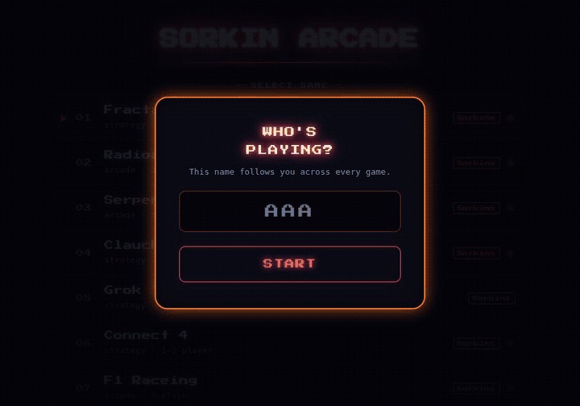

# Sorkin Arcade (digital-arcade)

Browser games whose pieces are fractal-shaded WebGL spheres (Mandelbrot, Julia, Newton).

Play: https://arcade.motisorkin.com



## What is here

- `index.html`: the arcade hub. It reads `games.json` to list the games.
- `engine/fractal-shell.js`: the shared engine. It owns the canvas stack, the WebGL sphere renderer, themes, 1P/2P modes, resizing, reduced motion, the animation loop, input, player names and high scores.
- `engine/highscores.js`: the high-score store (localStorage).
- `games/*.js`: one file per shell-based game.
- `<slug>.html`: each game built into one self-contained page.
- `checkers.html` and `f1-raceing.html` are standalone pages, not built from the shell.

## Make a game

A game is a plain object. The shell draws and runs it; the game only supplies the mechanics. Start from `games/_template.js`:

- `id`, `title`, `subtitle`, `aspect` (play-area width / height), `hint`
- `modes`: for example `[{ id: '1p', label: '1 Player' }, { id: '2p', label: '2 Players' }]`. Read the current one from `shell.mode`.
- `players` (optional): editable name fields, `{ defaultName, color }`
- `controls` (optional): extra buttons, `{ label, onClick(shell) }`
- `reset(shell)`, `resize(shell, w, h)`, `update(shell, dt)` (dt in seconds)
- `drawBackground(shell, ctx, w, h)` draws below the spheres; `drawForeground(shell, ctx, w, h)` draws above them.
- `spheres(shell)` returns the spheres for this frame: `{ x, y, r, tint, look, seed, zoom, capture, frozen }`. `look` is `'bands'` (Mandelbrot), `'stalks'` (Julia) or `'nova'` (Newton). `tint` 0 or 1 picks the theme color.
- `onPointerMove/Down/Up(shell, x, y)`, `onKeyDown/Up(shell, e)`

Coordinates are CSS pixels, with (0,0) at the top-left of the play area. The shell handles device pixel ratio and the WebGL y-flip.

A game can call `shell.newGame()`, `shell.setMode(id)`, `shell.recordScore(score)` (top-ten board, asks for initials) or `shell.reportWin()` (adds a win to the current player's tally).

To add one:

1. Copy `games/_template.js` to `games/<slug>.js` and set `window.<Name>Game`.
2. Add the slug to `GAMES` in `build.js`.
3. Run `node build.js <slug>` to write `<slug>.html`.
4. Add an entry to `games.json` so it appears in the hub.

## Build

```
node build.js <slug>    # build one game
node build.js hub       # re-inline the high-score store into index.html and scores.html
npm run build           # everything
npm test                # high-score tests
```

## Run locally

Serve the folder with any static server, then open http://localhost:8000:

```
python3 -m http.server 8000
```

The hub loads `games.json` with `fetch`, so opening `index.html` from disk will not list the games.

Issues welcome.

By Moti Sorkin · [github.com/motizzle](https://github.com/motizzle) · [motisorkin.com](https://motisorkin.com)
